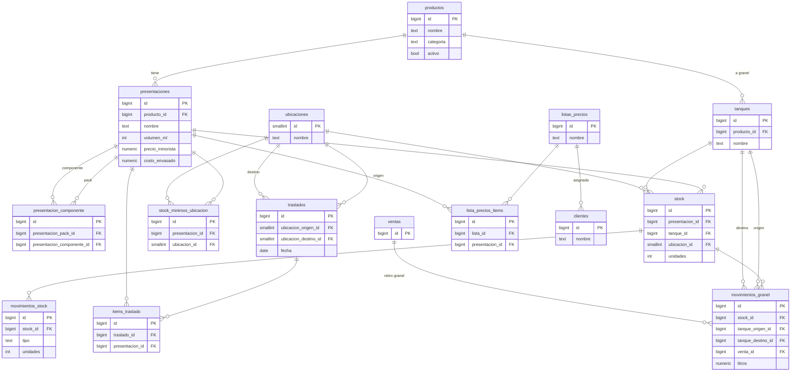
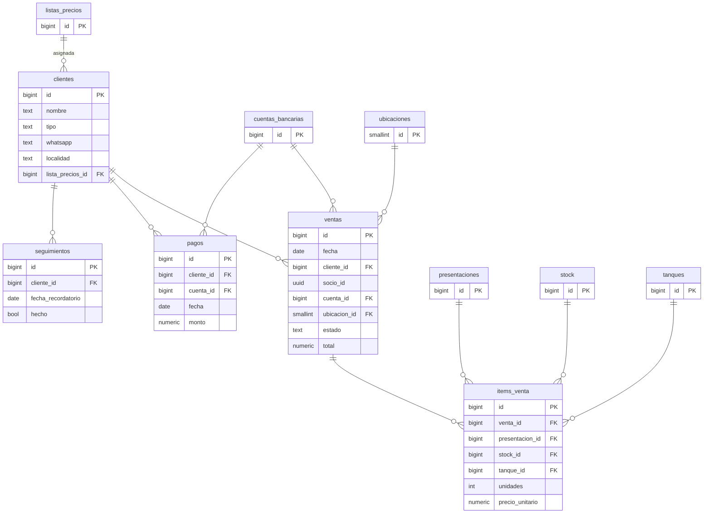
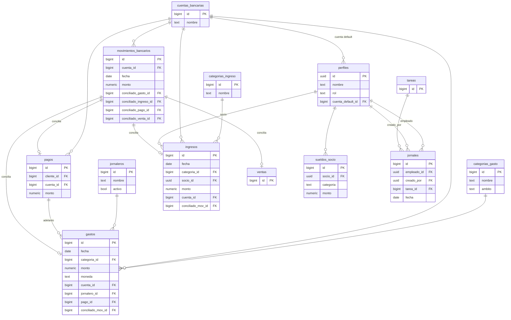
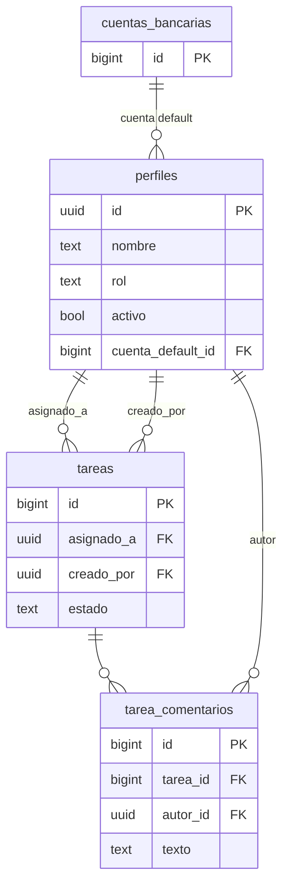
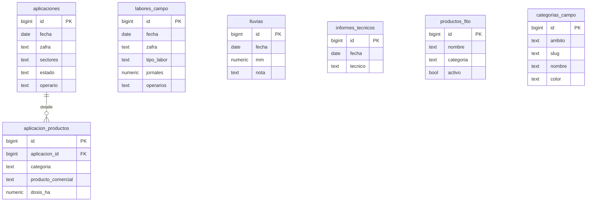
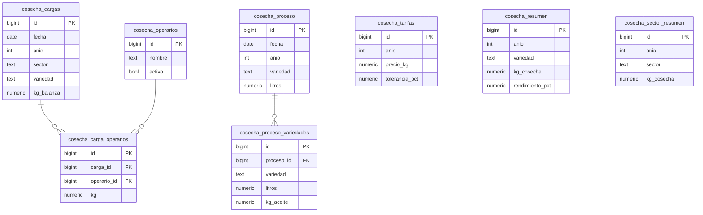
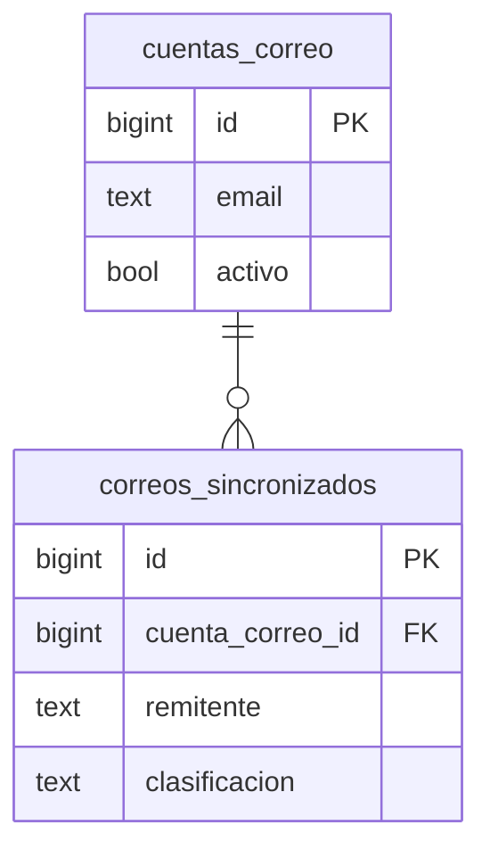
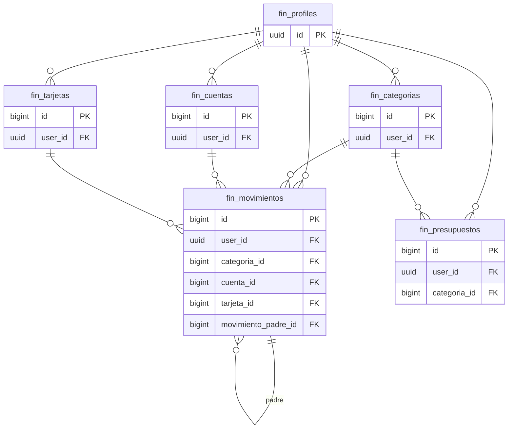

# MER — Modelo entidad-relación

Diagrama entidad-relación de la base Supabase de Sierras de Aiguá (`ogtssmliiftxaieectny`).

> Armado desde la **estructura viva** de la base (claves foráneas reales), no desde
> `supabase/schema.sql`, que refleja un diseño anterior (tenía `lotes`, `gastos_personales`,
> `movimientos_contables`). Este es el que corre hoy.

- **54** tablas · **68** relaciones (FK) · **8** módulos
- Notación pata de gallo: `uno ||--o{ muchos`. Cada caja lista **PK** (clave primaria) y **FK** (foránea).
- Campos `uuid` (`socio_id`, `creado_por`, `usuario_id`, `autor_id`…) apuntan a `auth.users` de
  Supabase; `perfiles` es su 1:1 en el esquema público.
- La **conciliación bancaria** es un par 1:1: cada `movimientos_bancarios` enlaza a un gasto,
  ingreso, pago o venta (hay FK en ambos sentidos; acá se dibuja una sola línea).
- `config_global` es una tabla suelta de configuración (sin relaciones); no aparece en ningún módulo.

Para regenerarlo, las FK se leen con:

```sql
select tc.table_name as origen, kcu.column_name as col, ccu.table_name as destino
from information_schema.table_constraints tc
join information_schema.key_column_usage kcu
  on tc.constraint_name = kcu.constraint_name and tc.table_schema = kcu.table_schema
join information_schema.constraint_column_usage ccu
  on tc.constraint_name = ccu.constraint_name and tc.table_schema = ccu.table_schema
where tc.constraint_type = 'FOREIGN KEY' and tc.table_schema = 'public'
order by origen, col;
```

---

## Módulo A — Catálogo, stock y logística

Productos y presentaciones, tanques a granel, stock por ubicación, movimientos, traslados y listas de precios.



---

## Módulo B — Ventas, CRM y cobros

Clientes, ventas e ítems (de qué stock/tanque salió), pagos mensuales y seguimientos comerciales.



---

## Módulo C — Finanzas y contabilidad

Gastos, ingresos, pagos y cuentas bancarias; los movimientos bancarios se **concilian** (1:1) con cada uno. Sueldos y jornales de socios.



---

## Módulo D — Usuarios y pendientes

Perfiles de socios (1:1 con `auth.users`), tareas compartidas y sus comentarios.



---

## Módulo E — Campo (cuaderno)

Aplicaciones de productos (+ detalle), labores de manejo, lluvias, informes técnicos, catálogo fito y categorías de color. Sin FK entre sí salvo aplicación → detalle: lluvias, labores, informes, fito y categorías son tablas autónomas.



---

## Módulo F — Cosecha

Cargas por operario (destajo), proceso en almazara con mezcla de variedades por tanque, tarifas y resúmenes por año/variedad/sector.



---

## Módulo G — Correo (Gmail)

Cuentas de correo conectadas por OAuth y los correos sincronizados/clasificados de cada una.



---

## Módulo H — App de finanzas personales (`fin_*`) · aislado

Cluster que **no se conecta** con el resto: vive en la misma instancia Supabase pero es otra app (usa `fin_profiles`, no `perfiles`).


